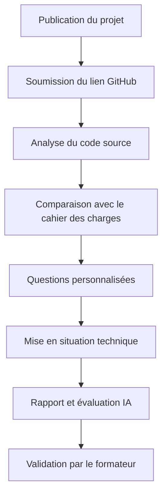

# SkillCheck AI

> Analyse. Évalue. Accompagne.

Plateforme intelligente d'évaluation et de suivi des compétences techniques des apprenants.

## Contexte du projet

Dans les formations en développement informatique, l'évaluation des projets nécessite une analyse du code source, une vérification des fonctionnalités et une validation des compétences acquises. Ces tâches peuvent demander beaucoup de temps aux formateurs.

SkillCheck AI est un projet Fil Rouge visant à faciliter ce processus grâce à l'intelligence artificielle, tout en conservant le formateur comme responsable de la validation finale.

## Objectifs

- Centraliser la gestion des projets et des livrables.
- Analyser les repositories GitHub des apprenants.
- Comparer les fonctionnalités implémentées avec le cahier des charges.
- Générer des questions personnalisées à partir du code source.
- Proposer des mises en situation techniques adaptées aux compétences évaluées.
- Faciliter le suivi pédagogique et la prise de décision du formateur.

## Fonctionnalités prévues

### Formateur

- Gérer les promotions et suivre les apprenants.
- Créer et publier des projets.
- Ajouter les cahiers des charges et définir les exigences.
- Définir les compétences à évaluer.
- Consulter les livrables et les rapports d'analyse.
- Consulter les réponses et les solutions des apprenants.
- Valider les évaluations et ajouter des commentaires.
- Accéder à un tableau de bord de suivi pédagogique.

### Apprenant

- Consulter les projets de sa promotion et leurs cahiers des charges.
- Soumettre un livrable via un lien GitHub.
- Participer à une session d'évaluation personnalisée.
- Répondre aux questions générées à partir de son code.
- Résoudre une mise en situation technique.
- Consulter ses résultats et les commentaires disponibles.

### Intelligence artificielle

- Analyser la structure et le contenu du code source.
- Identifier les fonctionnalités présentes, partielles ou manquantes.
- Fournir des justifications et des références au code analysé.
- Générer des questions techniques contextualisées.
- Générer des exercices de conception ou de programmation.
- Proposer une évaluation et un feedback pédagogique.

Les résultats de l'IA constituent une aide à l'évaluation et ne garantissent pas à eux seuls le bon fonctionnement du logiciel. La validation finale reste sous la responsabilité du formateur.

## Workflow



## Technologies envisagées

| Technologie | Utilisation |
|---|---|
| Java 21 | Langage backend |
| Spring Boot | Développement de l'API REST |
| Spring Data JPA / Hibernate | Persistance des données |
| PostgreSQL | Base de données |
| Spring Security / JWT | Authentification et autorisation |
| Spring AI | Intégration d'un modèle d'intelligence artificielle |
| JGit | Accès aux repositories Git |
| Liquibase | Migrations de base de données |
| MapStruct | Mapping entre entités et DTOs |
| Lombok | Réduction du code répétitif |
| Swagger / OpenAPI | Documentation de l'API |
| JUnit / Mockito | Tests unitaires |
| Maven | Gestion des dépendances et du build |
| React ou Angular | Interface frontend (choix à confirmer) |
| Git / GitHub | Gestion du code source |
| Lucidchart | Modélisation UML |

## Architecture prévue

Le backend repose sur une architecture en couches, séparant la présentation, la logique métier et la persistance des données.

```text
src/main/java/ma/youcode/skillcheck/
├── config/
├── controllers/
├── dtos/
│   ├── requests/
│   └── responses/
├── entities/
├── enums/
├── exceptions/
├── mappers/
├── repositories/
├── security/
├── services/
│   └── impl/
└── integrations/
    ├── ai/
    └── github/
```

## Sécurité

- Contrôle des accès selon les rôles Formateur et Apprenant.
- Protection des identifiants et des clés API via des variables d'environnement.
- Accès uniquement aux repositories autorisés.
- Traitement du code source comme une donnée non fiable, sans exécution directe sur le serveur principal.
- Protection des données personnelles et des résultats d'évaluation.

## Installation (prévue)

Prérequis : Java 21, PostgreSQL, Git, Maven ou Maven Wrapper et une clé API du fournisseur IA choisi.

Après initialisation du backend, configurer la connexion PostgreSQL et la clé API dans les variables d'environnement, puis lancer l'application :

```bash
./mvnw spring-boot:run
```

Sous Windows :

```powershell
.\mvnw.cmd spring-boot:run
```

## État du projet

Projet en phase de conception et d'initialisation. Les fonctionnalités et l'architecture décrites constituent la cible de développement et pourront évoluer.

## Auteur

Projet Fil Rouge — Formation Développement Full Stack.


 
 